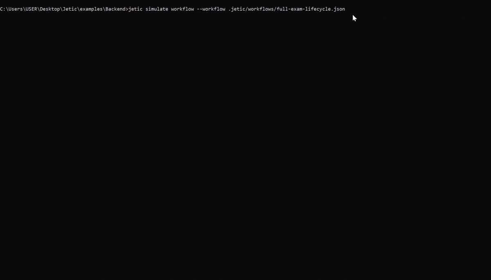

<div align="center">


<br/>
<p align="center">
  <a href="https://www.npmjs.com/package/jetic-cli"><picture><source media="(prefers-color-scheme: dark)" srcset="https://shieldcn.dev/npm/c15t.svg?variant=outline&size=xs&mode=dark"></picture></a>
  <a href="https://github.com/jeticlabs/Jetic/blob/main/LICENSE.md"><picture><source media="(prefers-color-scheme: dark)" srcset="https://shieldcn.dev/github/c15t/c15t/license.svg?variant=outline&size=xs&mode=dark"></picture></a>
  <a href="https://c15t.link/discord"><picture><source media="(prefers-color-scheme: dark)" srcset="https://shieldcn.dev/discord/1312171102268690493.svg?variant=outline&size=xs&mode=dark"></picture></a>
</p>

**The agentic, code-native API platform.**  
Scan your backend, model endpoints, author workflows, and simulate stateful API flows — no manual scripts, no stale docs.



[Website](https://www.jetic.space/cli) · [Docs](https://docs.jetic.space) · [Contributing](CONTRIBUTING.md)

</div>

---

## Install

```bash
npm install -g jetic-cli
```

> Or run without installing: `npx jetic-cli --help`

---

## Quickstart

```bash
# 1. Initialize your project
jetic init

# 2. Scan Express/TypeScript routes (auto-discovers endpoints)
jetic scan

# 3. Launch Jetic Studio
jetic dev
```

For all other stacks, connect via MCP and let your AI editor model the API for you — no scanner needed.

---

## MCP Setup (Recommended)

Connect Jetic to your AI editor (Cursor, Claude Code, VS Code, Windsurf, opencode) in seconds:

```json
{
  "mcp": {
    "jetic": {
      "type": "local",
      "command": ["cmd", "/c", "jetic", "mcp"],
      "cwd": "C:/path/to/your-backend",
      "enabled": true
    }
  }
}
```

> macOS/Linux: replace `["cmd", "/c", "jetic", "mcp"]` with `["jetic", "mcp"]`.

Full MCP setup guide → [docs.jetic.space](https://docs.jetic.space)

---

## CLI Reference

| Command | Description |
| :--- | :--- |
| `jetic init` | Scaffold `.jetic/` workspace |
| `jetic scan` | AST-scan Express/TS routes → `model.json` |
| `jetic inspect` | Inspect endpoints and model summary |
| `jetic simulate endpoint` | Simulate single or all endpoints |
| `jetic simulate workflow` | Execute a saved multi-step workflow |
| `jetic dev` | Launch Jetic Studio (port 8787) |
| `jetic mcp` | Start MCP server over stdio |
| `jetic memory` | View/manage runtime state |
| `jetic agent` | Run deterministic model agents |
| `jetic doctor` | Diagnose setup issues |
| `jetic upgrade` | Check and upgrade dependencies |

Full command reference → [docs.jetic.space](https://docs.jetic.space)

---

## Jetic Studio

`jetic dev` opens a local web IDE with:

- **Model Explorer** — browse, search, and manually add endpoints
- **Endpoint Inspect** — AST source viewer, schema explorer, live REST client
- **Workflow Simulations** — multi-step runner with SSE live streaming
- **Memory Inspector** — view and edit runtime state (`memory.json`)
- **Execution Traces** — ReactFlow node-graph observability
- **File Changes** — real-time source change tracker with MCP integration

---

## Contributing

See [CONTRIBUTING.md](CONTRIBUTING.md) for setup instructions and PR guidelines.

---

## License

[ISC](LICENSE)

<p align="center"><i>Built with care by the Jetic Team. Star us on GitHub if Jetic helps you.</i></p>